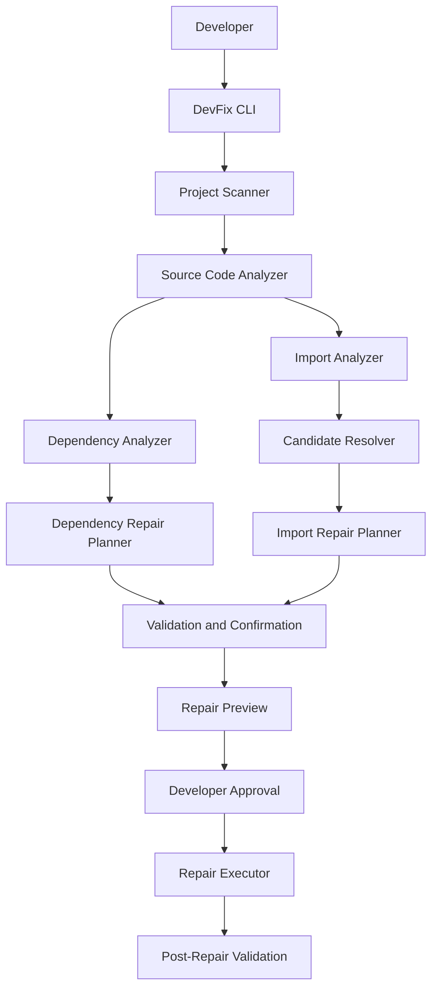
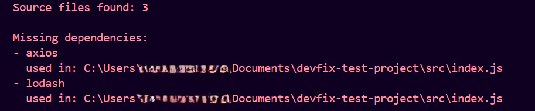
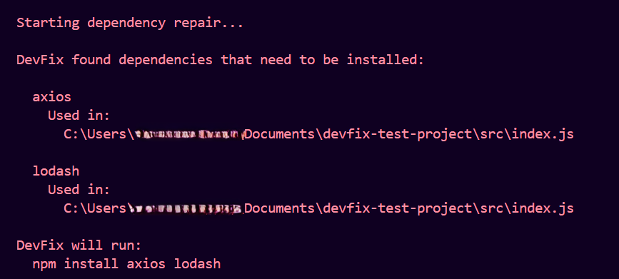
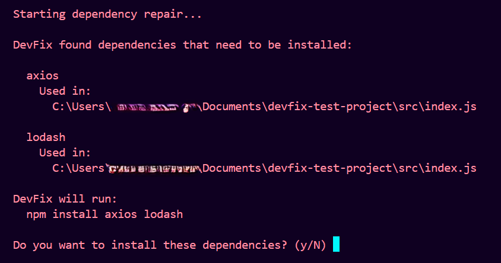

# DevFix – Automated Import & Dependency Repair CLI

<p align="center">
  **Detect. Resolve. Repair. Validate.**
</p>

<p align="center">
  A developer-focused Node.js CLI that automatically detects missing dependencies and unresolved imports in JavaScript and TypeScript projects, generates repair suggestions, and applies approved fixes safely.
</p>

<p align="center">
  
  
  
  
</p>

## Overview

Developers working with JavaScript and Node.js applications frequently encounter dependency and import-related problems.

A package may be imported but not installed. A dependency may be missing from `package.json`. A component or function may be used without its corresponding import statement. In larger projects, identifying and fixing these issues across multiple files can become repetitive and time-consuming.

**DevFix is being built to automate this process.**

DevFix is a Node.js-based command-line tool that analyzes a project, identifies missing dependencies and potentially unresolved imports, determines possible resolutions, and generates code modifications.

Instead of simply displaying errors, DevFix attempts to repair them through a structured workflow involving source-code analysis, candidate resolution, repair planning, preview, developer confirmation, and validation.

The primary goal is to reduce repetitive debugging while keeping developers in control of every modification.

### Core philosophy

**Detect locally → Resolve intelligently → Repair deterministically → Validate**

---

## The Problem We're Solving

Consider a JavaScript project containing the following code:

```javascript
function App() {
    const [count, setCount] = useState(0);

    return (
        <button onClick={() => setCount(count + 1)}>
            {count}
        </button>
    );
}
```

The application uses `useState`, but the required import is missing.

A developer must identify the missing identifier, determine which package exports it, and add the correct import.

The same problem occurs with external dependencies.

For example:

```javascript
import express from "express";
```

If Express is not installed, the project may fail during execution or build.

### Traditional debugging workflow

1. Run the application or build command.
2. Read the error message.
3. Locate the problematic file.
4. Identify the missing dependency or import.
5. Search for the correct package or export.
6. Install the package or add the import manually.
7. Run the application again.

This process becomes increasingly repetitive when multiple issues exist across a project.

### Our approach

DevFix combines dependency analysis and source-code import repair into one automated workflow.

Rather than requiring developers to manually investigate every issue, DevFix attempts to:

- Detect missing dependencies.
- Identify potentially missing imports.
- Discover suitable package exports.
- Generate import statements.
- Preview proposed modifications.
- Apply approved changes.
- Validate the resulting source code.

---

## Features

### 1. Automated Dependency Detection

DevFix analyzes dependencies by comparing `package.json` with the installed packages inside `node_modules`.

It identifies different dependency states:

| Dependency state | DevFix action |
|---|---|
| Declared and installed | No action required |
| Declared but not installed | Identify for installation |
| Not declared and not installed | Identify as a missing dependency |
| Installed but not declared | Flag for developer review |

### 2. AST-Based Source Code Analysis

DevFix uses Babel parsing and AST traversal to analyze source files.

Instead of depending entirely on regular expressions, it examines the structure of the source code.

It analyzes:

- Import declarations.
- Imported identifiers.
- Identifier references.
- Potentially undefined identifiers.
- Existing bindings and imports.

This provides a structured foundation for identifying missing imports.

### 3. Intelligent Candidate Resolution

When DevFix identifies a potentially missing import, it searches available package exports to identify possible sources for the missing identifier.

For example:

```javascript
useState
```

A possible resolution is:

```javascript
react → useState
```

The resolver classifies candidates into three categories:

| Status | Meaning |
|---|---|
| Resolved | A suitable candidate was identified |
| Ambiguous | Multiple possible candidates were found |
| Unresolved | No suitable candidate was identified |

Ambiguous and unresolved cases are not automatically repaired.

### 4. Automated Import Generation

Once a suitable candidate is identified, DevFix generates the appropriate import declaration.

Supported import styles include:

**Named imports**

```javascript
import { useState } from "react";
```

**Default imports**

```javascript
import Component from "some-package";
```

**Namespace imports**

```javascript
import * as utilities from "some-package";
```

### 5. Import Merging and Insertion

DevFix checks existing imports before inserting new declarations.

For example:

**Before**

```javascript
import { useEffect } from "react";
```

**After**

```javascript
import { useEffect, useState } from "react";
```

When merging is unsuitable, DevFix inserts a separate import statement.

The insertion process considers source-code structure, including existing imports, comments, directives, and shebangs.

### 6. Dependency Validation and Installation

Before installing a dependency, DevFix:

- Validates the package name.
- Checks whether the package exists in the npm registry.
- Displays the installation plan.
- Requests developer confirmation.
- Executes npm installation.
- Verifies the installation result.

### 7. Repair Preview

DevFix generates a unified diff before modifying source files.

Developers can inspect the proposed changes instead of allowing the tool to silently modify their code.

### 8. Developer-Controlled Execution

Both dependency installation and source-code modification require explicit approval.

The confirmation prompt defaults to **No**, preventing accidental execution.

### 9. Safe File Modification

The repair workflow includes safeguards such as checking whether a source file has changed since preview and validating the modified source code.

### 10. Transaction-Based Undo (In Progress)

A rollback mechanism is being developed to reverse previous DevFix source-code modifications.

The planned functionality includes:

- Creating a transaction for each repair execution.
- Backing up original source files.
- Recording original and repaired SHA-256 hashes.
- Maintaining transaction manifests.
- Checking whether files have changed after repair.
- Restoring verified backups.

The initial undo implementation will focus on source-code modifications, not npm dependency installation rollback.

---

## How DevFix Works

DevFix follows a modular, pipeline-based architecture.

### High-Level Workflow



### Step 1 – Project Scanning

DevFix identifies the project root and scans relevant source files.

It prepares the files for dependency and source-code analysis.

### Step 2 – Dependency Analysis

The dependency analyzer checks the project's package configuration and installed packages.

It determines which dependencies are already available and which require attention.

### Step 3 – Import Analysis

The source-code analyzer parses the files and extracts import declarations and identifier information.

It identifies potentially missing imports and collects external package references.

### Step 4 – Candidate Resolution

Potentially missing identifiers are passed to the candidate resolver.

The resolver searches available package exports and determines whether a suitable import source can be identified.

### Step 5 – Repair Planning

The repair planner converts analysis results into actionable operations.

It decides which dependencies should be installed and which import declarations can safely be generated, merged, or inserted.

### Step 6 – Preview and Confirmation

DevFix generates a diff preview and displays the proposed modifications.

The developer decides whether to proceed.

### Step 7 – Repair Execution

Approved dependency installations and source-code modifications are executed.

### Step 8 – Validation

DevFix validates the resulting source code and verifies dependency installation results.

---

## Example: Automated Import Repair

Suppose a file contains:

**Before**

```javascript
import { useEffect } from "react";

function App() {
    const [count, setCount] = useState(0);

    return <div>{count}</div>;
}
```

DevFix identifies `useState` as a potentially missing import.

The candidate resolver identifies React as a possible export source.

The repair planner generates the required modification.

**Proposed change**

```diff
-import { useEffect } from "react";
+import { useEffect, useState } from "react";
```

The developer reviews the diff and approves the modification.

**After repair**

```javascript
import { useEffect, useState } from "react";

function App() {
    const [count, setCount] = useState(0);

    return <div>{count}</div>;
}
```

The modified source is then validated.

---

## Terminal Demonstrations

The following sections are reserved for actual screenshots captured while running DevFix.

Replace the placeholder image paths with your screenshots.

### 1. Dependency Detection

Shows DevFix identifying missing and incorrectly installed dependencies.



*Figure 1: Dependency analysis and detection output.*

### 2. Import Detection

Shows DevFix analyzing source files and identifying potentially missing imports.


*Figure 2: AST-based import analysis and missing identifier detection.*

### 3. Candidate Resolution

Shows how DevFix searches package exports and classifies resolution candidates.



*Figure 3: Candidate resolution results.*

### 4. Dependency Installation Confirmation

Shows the dependency repair plan and developer approval prompt.



*Figure 4: Developer-controlled dependency installation.*

### 5. Import Repair Preview

Shows the unified diff generated before modifying source files.


*Figure 5: Proposed source-code changes before execution.*

### 6. Successful Repair

Shows the final repair execution and validation output.


*Figure 6: Successful automated repair.*

---

## Technology Stack

| Technology | Purpose |
|---|---|
| JavaScript | Primary programming language |
| Node.js | Runtime environment |
| Commander.js | CLI command management |
| Babel Parser | JavaScript/TypeScript-related source parsing |
| Babel Traverse | AST traversal and identifier analysis |
| Babel AST utilities | Structured source-code modification |
| Node.js File System APIs | Reading and modifying source files |
| Node.js Crypto | SHA-256 hashes and transaction identifiers |
| Node.js Child Process APIs | npm installation execution |
| npm Registry API | Package existence validation |
| diff | Unified repair previews |

---

## Project Architecture

DevFix follows a modular architecture where each component is responsible for a specific part of the repair pipeline.

```text
src/
│
├── analyzer/
│   ├── parser.js
│   ├── imports.js
│   ├── classify.js
│   ├── dependencies.js
│   └── analyze.js
│
├── scanner/
│   └── scanner.js
│
├── dependency/
│   ├── dependency-checker.js
│   ├── dependency-planner.js
│   ├── dependency-validator.js
│   ├── dependency-confirmation.js
│   ├── dependency-repair.js
│   ├── npm-installer.js
│   └── installation-verifier.js
│
├── resolver/
│   ├── candidate-resolver.js
│   └── package-exports.js
│
├── repair/
│   ├── import-generator.js
│   ├── import-checker.js
│   ├── repair-planner.js
│   ├── import-inserter.js
│   ├── import-merger.js
│   ├── repair-applicator.js
│   ├── repair-safety.js
│   ├── repair-preview.js
│   ├── repair-confirmation.js
│   └── file-writer.js
│
├── undo/
│   ├── transaction-manager.js
│   └── backup-manager.js
│
├── commands/
│   └── fix.js
│
└── cli.js
```

*Note: The directory structure above represents the major modules. Some utility and supporting files have been omitted for readability. The undo module is still under development.*

### Architectural Design Principles

**Separation of concerns:** Scanning, analysis, dependency management, resolution, planning, and execution are separated into independent modules.

**Deterministic processing:** The primary repair pipeline uses explicit rules and package metadata rather than requiring an AI model for routine operations.

**Developer control:** Proposed changes are presented before execution.

**Extensibility:** New analyzers, resolution strategies, and repair operations can be introduced without redesigning the complete application.

---

## Getting Started

### Prerequisites

- Node.js 20 or later.
- npm.
- A JavaScript or TypeScript project to analyze.

### 1. Clone the repository

```bash
git clone <YOUR_GITHUB_REPOSITORY_URL>
```

```bash
cd devfix
```

### 2. Install dependencies

```bash
npm install
```

### 3. Link DevFix locally

```bash
npm link
```

This makes the `devfix` CLI command available globally in your local development environment.

### 4. Run DevFix inside a target project

Navigate to the JavaScript or TypeScript project you want to analyze.

```bash
cd path/to/your-project
```

Run the available commands:

```bash
devfix check
```

```bash
devfix fix
```

---

## CLI Commands

| Command | Description |
|---|---|
| `devfix check` | Analyze the project and report detected dependency and import issues. |
| `devfix fix` | Run the repair workflow, display proposed changes, and execute approved repairs. |
| `devfix undo` | Planned command for reversing the latest eligible repair transaction. |

*The undo command is not yet available in the current implementation.*

---

## Development Journey

DevFix is being developed incrementally, with each major component implemented and tested before integration.

| Phase | Implementation |
|---|---|
| 1 | CLI foundation and project scanning |
| 2 | AST-based source-code analysis |
| 3 | Dependency detection and classification |
| 4 | Package validation and installation |
| 5 | Candidate resolution and package export discovery |
| 6 | Import generation, merging, and insertion |
| 7 | Repair planning, safety checks, and validation |
| 8 | Unified diff previews and developer confirmation |
| 9 | End-to-end dependency and import repair integration |
| 10 | Transaction manager and backup system for undo (in progress) |

---

## Current Scope and Limitations

DevFix currently focuses on common dependency and import-related problems in JavaScript and TypeScript projects.

Some limitations are important to understand:

- Dynamic imports and runtime-generated references require additional analysis.
- An undefined identifier is not necessarily a missing import.
- Candidate resolution can be ambiguous when multiple packages export the same identifier.
- Package export discovery does not yet fully model every target project's module-resolution environment.
- Complex package structures may require additional resolution strategies.
- Successful syntax validation does not guarantee complete runtime correctness.
- Undo and transaction recovery are still under development.
- npm installation rollback is outside the initial undo scope.

These limitations define the current V1 scope and guide future development.

---

## Roadmap

### V1 – Deterministic Import and Dependency Repair

- [x] Project scanning.
- [x] Dependency state detection.
- [x] Package-name validation.
- [x] npm registry validation.
- [x] Dependency installation and verification.
- [x] AST-based import analysis.
- [x] Undefined identifier analysis.
- [x] Candidate resolution.
- [x] Named, default, and namespace import generation.
- [x] Import merging and insertion.
- [x] Repair safety checks.
- [x] Unified diff previews.
- [x] Developer confirmation.
- [x] Controlled file writing.
- [x] End-to-end repair workflow.
- [ ] Transaction-based undo.
- [ ] Comprehensive undo and recovery tests.
- [ ] Public V1 release.

### V2 – AI-Assisted Resolution

Potential improvements:

- Optional LLM-assisted candidate resolution.
- Better handling of ambiguous imports.
- Context-aware repair recommendations.
- Explanation of suggested modifications.
- Validation of AI-generated repair candidates.

AI will act as an optional fallback rather than replacing the deterministic repair engine.

### V3 – Advanced Developer Automation

Potential future improvements:

- Monorepo support.
- IDE integrations.
- CI/CD integration.
- Dependency compatibility analysis.
- Incremental scanning.
- Plugin-based repair rules.
- Advanced repair analytics.

---

## Evaluation and Benchmarking

DevFix is intended to be evaluated using controlled test projects containing known dependency and import-related issues.

The planned evaluation metrics include:

| Metric | What it measures |
|---|---|
| Detection precision | Correctness of detected issues |
| Detection recall | Ability to identify actual issues |
| Repair success rate | Percentage of repairs producing the expected result |
| False-repair rate | Percentage of applied repairs that are incorrect |
| Mean runtime | Average time required to complete analysis and repair |

A conventional manual/tool-assisted debugging workflow will serve as the comparison baseline.

Quantitative results should be added after controlled benchmark experiments are completed.

---

## Future Vision

The long-term vision for DevFix is to evolve from a dependency and import repair CLI into a broader developer automation tool.

The system will continue to prioritize deterministic operations and explicit validation.

An optional AI-assisted layer may be introduced for cases where conventional resolution strategies cannot confidently identify the correct solution.

The goal is not to replace developers, but to automate repetitive engineering tasks while keeping code modifications transparent, reviewable, and reversible.

---

## Contributing

Contributions, suggestions, and bug reports are welcome.

Potential areas for contribution include:

- Improving package export resolution.
- Expanding language and syntax support.
- Improving AST-based identifier analysis.
- Adding test cases for complex import structures.
- Improving repair safety and recovery.
- Supporting additional project configurations.

---

## Author

**Aryan Makhija**

Full-Stack Developer | Node.js | Backend Engineering | AI & RAG Systems

- GitHub: [Your GitHub Profile](<https://github.com/Aryan-Makhija>)
- LinkedIn: [Your LinkedIn Profile](<https://www.linkedin.com/in/aryan-makhija-1a43a6352>)

---

<p align="center">
  **DevFix – Making dependency and import repair simpler, safer, and more reliable.**
</p>
